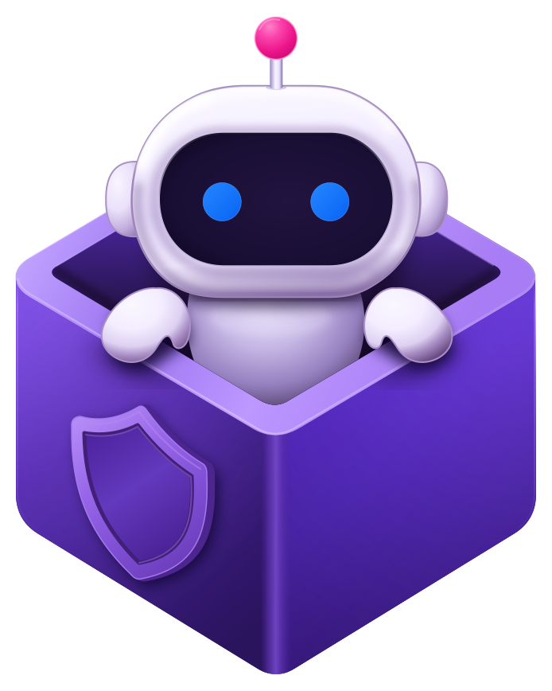

<p align="center">
  
</p>

<h1 align="center">Sandbox</h1>

Run coding agents in a container with your tools, your settings, and limits on host and network access.
Use [Claude Code](https://code.claude.com/docs/en/overview), [Codex](https://developers.openai.com/codex/cli/), [OpenCode](https://opencode.ai/docs/), [Pi](https://github.com/badlogic/pi-mono), or any command.

```bash
sandbox run claude
```

## Why Sandbox?

Sandbox focuses on customizability and developer experience for daily local work:

- Keep personal tools in a user image and project dependencies in a project image.
- Share team configuration in the repository without giving up personal settings.
- Choose which files, credentials, settings, and network services the agent can use.
- Keep agent state and dependency caches between runs.
- Use [Docker](https://docs.docker.com/engine/), [Podman](https://podman.io/docs), or [Apple `container`](https://github.com/apple/container) with the same CLI.
- Run `sandbox assist` for help with setup and troubleshooting.

Other tools offer customization too.
Choose Sandbox if this combination fits how you work, not because it promises the strongest isolation.
See [alternatives](#alternatives) at the end.

## What does it protect?

Sandbox reduces the damage from agent mistakes and prompt injection compared with running an agent directly on your host.
It is not perfect protection.

- The agent cannot read or change host files that are not exposed to the container.
- Outbound connections are restricted to an allowlist.
- Commands run as a non-root container user.
- Project configuration requires trust before Sandbox applies it.

The boundaries have limits:

- The whole project is writable by default, including hidden files and project secrets.
  Keep backups and review changes.
- Mounted files, forwarded credentials, and allowed services are available to the agent.
  An allowed service can receive your data.
- Clipboard access is enabled by default for attached sessions.
  Container processes can read or replace your host clipboard.
- Allowed host commands run with your host permissions, outside the container boundary.
- Container or runtime vulnerabilities can break isolation.
  Sandbox does not defend against an attacker who gains root inside the container.

`sandbox init` allows common development domains so agents can use APIs, package registries, and code hosts.
For stricter security, remove domains you do not need from `allow_network` in your user configuration.
It also shares selected host agent paths, including writable `~/.agents`.
Review the generated configuration before the first run.
Read the [security guide](docs/SECURITY.md) for the complete boundary and safer settings.

## Quickstart

### 1. Install the prerequisites

- [Node.js](https://nodejs.org/en/download) 24.22.1 or a later Node.js 24 release on the host.
- A running container runtime: [Docker](https://docs.docker.com/engine/), [Podman](https://podman.io/docs/installation), or [Apple `container`](https://github.com/apple/container).
  Follow [runtime setup](docs/RUNTIMES.md) before installing one, especially on Windows or Apple silicon.

### 2. Install and configure Sandbox

Install with [npm](https://docs.npmjs.com/cli/commands/npm-install), [pnpm](https://pnpm.io/cli/add), or [Bun](https://bun.sh/docs/pm/cli/install):

```bash
npm install -g @maibornwolff/sandbox
# or: pnpm add -g @maibornwolff/sandbox
# or: bun install -g @maibornwolff/sandbox
```

All three options still need the host Node.js version listed above.
Use the same package manager for [future updates](docs/UPDATES.md#update-the-cli).
Then initialize your user setup:

```bash
sandbox init
```

Select the agents and tools you need in the setup prompts.
Review the generated user `config.toml` at the path shown by the command.
The usual location is `~/.config/sandbox/config.toml` on macOS and Linux, or `%APPDATA%/sandbox/config.toml` on Windows.

For API-key authentication, set the key in the host terminal where you will run Sandbox.
For example, in [Bash](https://www.gnu.org/software/bash/manual/) or [zsh](https://zsh.sourceforge.io/Doc/), use `export ANTHROPIC_API_KEY='your-key'`.
To keep it across terminals, use your shell's startup file or a secret manager.
Do not put the key in the repository.

In the user `config.toml` created above, find the existing `env` list and uncomment or add the key's name:

```toml
# Inside the existing env = [ ... ] list:
"ANTHROPIC_API_KEY",
```

Keep the other entries in that list.
Only the name goes in the configuration, not the secret value.
No API keys are forwarded by default.
For subscription login or Codex host authentication, follow [agent authentication](docs/AUTHENTICATION.md).
To disable host clipboard access, add `clipboard = "disabled"` to the user configuration.
See [clipboard settings](docs/CLIPBOARD.md#disable-access) for project overrides.

### 3. Check setup and run

```bash
sandbox doctor
cd your-project
sandbox run claude
```

Replace `claude` with an installed agent or command, such as `codex` or `npm test`.
The first run builds the tool images and can take several minutes.
Later runs reuse cached images and compatible running containers.
The agent edits your real project files, not a disposable copy.

For an interactive container shell, run `sandbox`.
For help, run `sandbox assist` on the host from your project directory.
It starts a host agent with the Sandbox docs and configuration paths in context.

## Features

### Customize your environment

- [Custom tools and images](docs/LAYERED-IMAGES.md): install personal and project tools.
- [Project configuration](docs/PROJECTS.md): share team settings and review trust prompts.
- [Shared settings](docs/SETTINGS-SYNC.md): reuse agent configuration without replacing container defaults.
- [Persistence](docs/PERSISTENCE.md): keep agent state and separate container dependencies from host dependencies.
- [Agent skills](docs/AGENT-SKILLS.md): share skills between agents and projects.
- [Shell customization](docs/SHELL.md): add aliases, environment variables, and shell setup.

### Control access

- [File mounts](docs/MOUNTS.md): expose selected host paths or make the project read-only.
- [Network access](docs/NETWORK-FIREWALL.md): allow services and inspect blocked requests.
- [Agent authentication](docs/AUTHENTICATION.md): choose which credentials the agent can use.
- [Clipboard access](docs/CLIPBOARD.md): copy text and images, or disable host access.
- [Host commands](docs/HOST-COMMANDS.md): permit specific commands outside the container.

### Daily work

- [Sessions and containers](docs/SESSIONS.md): reuse containers, run quietly, and stop sessions.
- [AI-assisted help](docs/ASSIST.md): ask an agent to explain or change your setup.
- [Updates and cleanup](docs/UPDATES.md): update the CLI and tools, or remove stored data.

## Reference and help

- [Configuration reference](docs/CONFIGURATION.md): paths, merge rules, environment variables, and all configuration fields.
- [Troubleshooting](docs/TROUBLESHOOTING.md): diagnose startup, login, build, and network failures.
- [Documentation index](docs/README.md): user guides.
- `sandbox --help` and `sandbox <command> --help`: commands and options for your installed version.

## Contributing

Read [CONTRIBUTING.md](CONTRIBUTING.md) to build, test, or change Sandbox.
Start with the short [architecture guide](contributing/ARCHITECTURE.md) to understand the system.
Report vulnerabilities through [SECURITY.md](SECURITY.md).
Sandbox uses the [BSD 3-Clause License](LICENSE).

Built by [MaibornWolff](https://www.maibornwolff.de/).

## Alternatives

These tools make different trade-offs.
Check their current docs before choosing one:

- [Docker Sandboxes](https://docs.docker.com/ai/sandboxes/): microVM-based agent environments, local or cloud, with network policies and reusable customization kits.
  The standalone `sbx` CLI does not require Docker Desktop, and local use is free.
  A [Docker sign-in](https://docs.docker.com/ai/sandboxes/install/#sign-in) is required.
- [NVIDIA OpenShell](https://build.nvidia.com/openshell): an agent runtime with filesystem, network, and process policies, credential handling, and a gateway for managing sandboxes.
- [microsandbox](https://github.com/superradcompany/microsandbox): local microVMs with a Docker-like CLI and SDKs for running untrusted workloads from applications.
- [Anthropic Sandbox Runtime](https://github.com/anthropic-experimental/sandbox-runtime): operating-system sandboxing for commands, with filesystem and network controls.
- [yolobox](https://github.com/finbarr/yolobox) and [ClaudeBox](https://github.com/RchGrav/claudebox): other container-based agent environments.
- [Claude Code devcontainer](https://github.com/anthropics/claude-code/tree/main/.devcontainer): a reference development container with a network firewall.
- [clamp](https://github.com/Richargh/clamp): Docker wrapper scripts for Claude Code, OpenCode, and Pi, with workspace mounts and a domain allowlist.
- [Firejail](https://firejail.wordpress.com/): Linux application sandboxing.
