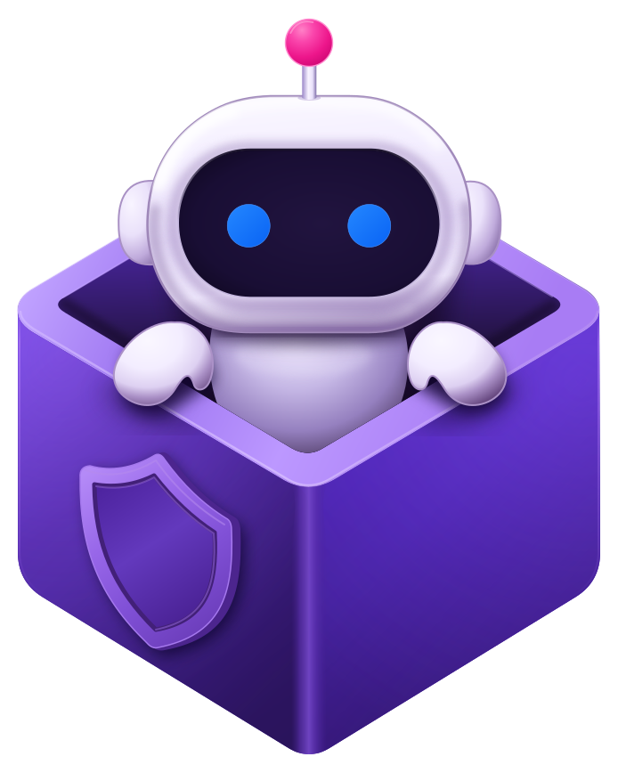

<p align="center">
  
</p>

<h1 align="center">Sandbox</h1>

Run coding agents in a container with your tools, your settings, and limits on host and network access.
Use [Claude Code](https://code.claude.com/docs/en/overview), [Codex](https://developers.openai.com/codex/cli/), [OpenCode](https://opencode.ai/docs/), [Pi](https://github.com/badlogic/pi-mono), or any command.

```bash
sandbox run claude
```

[Security model](docs/SECURITY.md) · [Quickstart](#quickstart) · [User guides](docs/README.md)

## Security and trade-offs

**Sandbox limits what an agent can reach, but it does not make untrusted code safe.**
Read the [security model](docs/SECURITY.md) before sharing host files or credentials with an agent.

- **The agent works on real files.** The whole project is writable by default, including hidden files and project secrets.
  Starting in a subdirectory does not narrow that access.
- **Trust can grant access outside the project.** [Approved external mounts](docs/SECURITY.md#project-trust-and-external-mounts) let a project use shared code or data in a parent or sibling folder.
  Review the resolved host paths and access modes before approving the project configuration.
  Read-only access still lets the agent read and copy files.
- **Network limits do not prevent data disclosure.** The network allowlist limits destinations, but an allowed service can receive data the agent can read.
- **Host integrations extend access.** Attached sessions can read or replace the host clipboard by default.
  Allowed host commands run with your host permissions.
- **Container isolation has limits.** Sessions run as a non-root user, but runtime vulnerabilities or container root can break the controls.

**Review the generated settings before the first run.** `sandbox init` allows common development domains and shares selected host paths, including writable `~/.agents`.
Remove entries you do not need.

## Why Sandbox?

- **Customize your tools.** Keep personal tools in a user image and project dependencies in a project image.
- **Share project settings.** Commit team configuration without replacing personal settings.
- **Keep state between runs.** Reuse agent state and dependency caches.
- **Choose your runtime.** Use Docker, Podman, or Apple `container` with the same CLI.

See [alternatives](#alternatives) if you need a different isolation boundary.

## Quickstart

### 1. Install the prerequisites

- [Node.js](https://nodejs.org/en/download) on the host: 24.22.1 or a later Node.js 24 release, or 26.13.1 or a later Node.js 26 release.
- A running container runtime: [Docker](https://docs.docker.com/engine/), [Podman](https://podman.io/docs/installation), or [Apple `container`](https://github.com/apple/container).
  Follow [runtime setup](docs/RUNTIMES.md) before installing one, especially on Windows or Apple silicon.

### 2. Install and configure Sandbox

Install with [npm](https://docs.npmjs.com/cli/commands/npm-install), [pnpm](https://pnpm.io/cli/add), or [Bun](https://bun.sh/docs/pm/cli/install):

```bash
npm install -g @maibornwolff/sandbox
# or: pnpm add -g @maibornwolff/sandbox
# or: bun install -g @maibornwolff/sandbox
```

Use the same package manager for [updates](docs/UPDATES.md#update-the-cli).
Then initialize your user configuration:

```bash
sandbox init
```

Select the agents and tools you need.
Open the user `config.toml` at the path shown by `sandbox init`.
Before you run an agent:

- **Set up authentication.** Sandbox does not forward API keys by default.
  To forward one, set it in your host environment and add only its name to the existing `env` list.
  See [agent authentication](docs/AUTHENTICATION.md) for API keys, subscription login, and host authentication.
- **Review clipboard access.** Set `clipboard = "disabled"` if the agent does not need the host clipboard.
  See [clipboard settings](docs/CLIPBOARD.md#disable-access) for project overrides.

### 3. Check setup and run

```bash
sandbox doctor
cd your-project
sandbox run claude
```

Replace `claude` with an installed agent or command, such as `codex` or `npm test`.
The first run can take several minutes to build the tool images.
Later runs reuse cached images and compatible containers.

- **Open a container shell:** Run `sandbox`.
- **Get setup help:** Run `sandbox assist` on the host from your project directory.

## Features

### Customize your environment

- [Custom tools and images](docs/LAYERED-IMAGES.md): install personal and project tools.
- [Project configuration](docs/PROJECTS.md): share team settings and review trust prompts.
- [Shared settings](docs/SETTINGS-SYNC.md): reuse agent configuration without replacing container defaults.
- [Persistence](docs/PERSISTENCE.md): keep agent state and separate container dependencies from host dependencies.
- [Agent skills](docs/AGENT-SKILLS.md): share skills between agents and projects.
- [Shell customization](docs/SHELL.md): add aliases, environment variables, and shell setup.

### Control access

- [File mounts](docs/MOUNTS.md): expose selected host paths or make the project read-only.
- [Network access](docs/NETWORK-FIREWALL.md): allow services and inspect blocked requests.
- [Agent authentication](docs/AUTHENTICATION.md): choose which credentials the agent can use.
- [Clipboard access](docs/CLIPBOARD.md): copy text and images, or disable host access.
- [Host commands](docs/HOST-COMMANDS.md): permit specific commands outside the container.

### Daily work

- [Sessions and containers](docs/SESSIONS.md): reuse containers, run quietly, and stop sessions.
- [AI-assisted help](docs/ASSIST.md): ask an agent to explain or change your setup.
- [Updates and cleanup](docs/UPDATES.md): update the CLI and tools, or remove stored data.

## Reference and help

- [Configuration reference](docs/CONFIGURATION.md): paths, merge rules, environment variables, and all configuration fields.
- [Troubleshooting](docs/TROUBLESHOOTING.md): diagnose startup, login, build, and network failures.
- [Documentation index](docs/README.md): user guides.
- `sandbox --help` and `sandbox <command> --help`: commands and options for your installed version.

## Contributing

- [Contributor guide](CONTRIBUTING.md): build, test, and change Sandbox.
- [Architecture guide](contributing/ARCHITECTURE.md): understand the system and its boundaries.
- [Security policy](SECURITY.md): report vulnerabilities privately.

Built by [MaibornWolff](https://www.maibornwolff.de/) under the [BSD 3-Clause License](LICENSE).

## Alternatives

These tools make different trade-offs.
Check their current docs before choosing one:

- [Docker Sandboxes](https://docs.docker.com/ai/sandboxes/): microVM-based agent environments, local or cloud, with network policies and reusable customization kits.
  The standalone `sbx` CLI does not require Docker Desktop, and local use is free.
  A [Docker sign-in](https://docs.docker.com/ai/sandboxes/install/#sign-in) is required.
- [NVIDIA OpenShell](https://build.nvidia.com/openshell): an agent runtime with filesystem, network, and process policies, credential handling, and a gateway for managing sandboxes.
- [microsandbox](https://github.com/superradcompany/microsandbox): local microVMs with a Docker-like CLI and SDKs for running untrusted workloads from applications.
- [Anthropic Sandbox Runtime](https://github.com/anthropic-experimental/sandbox-runtime): operating-system sandboxing for commands, with filesystem and network controls.
- [yolobox](https://github.com/finbarr/yolobox) and [ClaudeBox](https://github.com/RchGrav/claudebox): other container-based agent environments.
- [Claude Code devcontainer](https://github.com/anthropics/claude-code/tree/main/.devcontainer): a reference development container with a network firewall.
- [clamp](https://github.com/Richargh/clamp): Docker wrapper scripts for Claude Code, OpenCode, and Pi, with workspace mounts and a domain allowlist.
- [Firejail](https://firejail.wordpress.com/): Linux application sandboxing.
