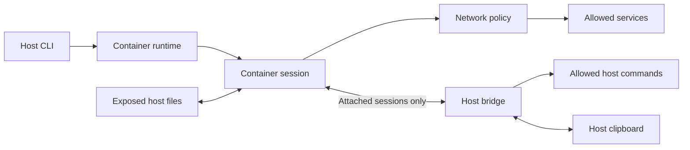

# Architecture

Read this guide when changing Sandbox's boundaries or lifecycle.
For setup and configuration, use the [user guides](../docs/README.md).

## Boundaries

Sandbox has a host CLI and tools that run inside a container.

The host CLI reads configuration, checks project trust, selects images, prepares storage, and opens sessions.
The container startup installs firewall rules before exposing a ready session.
Agent commands run as the non-root Sandbox user.

The authenticated, encrypted host bridge exists for attached sessions.
Host-command and clipboard permissions are separate capabilities.
It is an explicit host access path, not part of filesystem isolation.
See [security](../docs/SECURITY.md).

## Code ownership

Dependencies point inward:

- `src/apps/`: executable composition roots for the host CLI and container tools.
- `src/modules/`: product workflows and their APIs.
- `src/platform/`: process, filesystem, runtime, terminal, and other technical boundaries.
- `src/shared/`: pure product-independent helpers.

Components expose public APIs through `index.ts`.
Modules do not call runtime binaries directly.
The container-runtime adapters own runtime-specific commands, image building, and storage behavior.
See [repository guidance](../AGENTS.md) for dependency and ownership rules.

## Configuration, images, and data

[Configuration](../docs/CONFIGURATION.md) separates built-in defaults, user preferences, project requirements, and one-run overrides.
Sandbox resolves project mounts before checking trust so the approval covers the requested access.
It checks trust before project files affect access or builds.
See the [security model](../docs/SECURITY.md#project-trust-and-external-mounts) for the intended boundary.

[Image layers](../docs/LAYERED-IMAGES.md) separate base, user, and project tools.
A changed parent invalidates child layers.
Every project inherits the user layer when one exists.

Runtime program files are delivered separately from tool images.
The host caches a versioned, content-identified package and mounts it read-only.
Runtime-only changes select a new compatible container without rebuilding tool images.
Active sessions keep their existing runtime package.

Host data has distinct lifetimes:

- Project and additional mounts expose selected host paths directly.
- Persistent storage retains container data after removal.
- Shared settings use writable mounts or startup copies.
- Other container data is disposable.

See [mounts](../docs/MOUNTS.md), [persistence](../docs/PERSISTENCE.md), and [shared settings](../docs/SETTINGS-SYNC.md) for the user-visible contracts.

## Session lifecycle

1. Merge configuration and check trust.
2. Select or build the tool image.
3. Prepare runtime files, mounts, and storage.
4. Reuse a compatible running container or start one.
5. For a new container, configure the firewall, apply copied settings, and wait for required services.
6. Run `container.start` hooks before publishing readiness.
7. Open the attached session bridge and enabled clipboard access, then run `session.start` hooks.
8. Run the attached command as the non-root user.
9. End the attached session before closing its capabilities.
10. On graceful container shutdown, close readiness and stop active sessions before running `container.stop` hooks.
11. Synchronize new mount-mode settings before the container exits.

Concurrent sessions can share one container.
They are not separate security domains.
Reuse depends on configuration, image identity, and runtime content.
Session-only environment and hook changes do not prevent reuse.
The trusted container hook plan is fixed at boot and is part of the container reuse identity, not the tool image identity.

The container entrypoint owns container events.
The host session workflow owns session events and cleanup.
On supported hosts it also publishes a private foreground-job record during launch and retires it when the attachment ends, before end hooks.
The host process adapter verifies the job instance. The container runtime adapter binds the exact runtime endpoint and container.
The guest can confirm that the selected session is ready to query, but it cannot choose the host job or target.
See [lifecycle hooks](../docs/CONFIGURATION.md#lifecycle-hooks) for configuration.

Keep detailed adapter behavior in its owning code and tests.
For test design when changing lifecycle or external boundaries, use the [test-writing skill](../.agents/skills/test-writing/SKILL.md).
