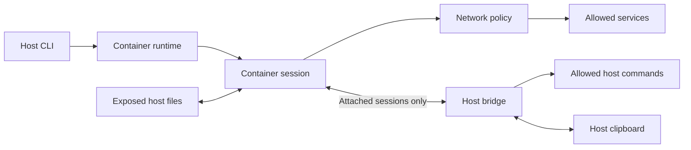

# Architecture

Read this guide when changing Sandbox's boundaries or lifecycle.
For setup and configuration, use the [user guides](../docs/README.md).

## Boundaries

Sandbox has a host CLI and tools that run inside a container.

The host CLI reads configuration, checks project trust, selects images, prepares storage, and opens sessions.
The container startup installs firewall rules before exposing a ready session.
Agent commands run as the non-root Sandbox user.

The authenticated, encrypted host bridge exists for attached sessions.
Host-command and clipboard permissions are separate capabilities.
It is an explicit host access path, not part of filesystem isolation.
See [security](../docs/SECURITY.md).

The network proxy checks the resolved destination addresses of allowed domains.
It denies loopback, link-local, private, unspecified, and multicast destinations.
Explicitly allowed IP literals and container runtime host access names can reach private addresses.
A domain under an allowed wildcard that resolves to a private address stays blocked.

## Code ownership

Dependencies point inward:

- `src/apps/`: executable composition roots for the host CLI and container tools.
- `src/modules/`: product workflows and their APIs.
- `src/platform/`: process, filesystem, runtime, terminal, and other technical boundaries.
- `src/shared/`: pure product-independent helpers.

Components expose public APIs through `index.ts`.
Modules do not call runtime binaries directly.
The container-runtime adapters own runtime-specific commands, image building, and storage behavior.
See [repository guidance](../AGENTS.md) for dependency and ownership rules.

## Configuration, images, and data

[Configuration](../docs/CONFIGURATION.md) separates built-in defaults, user preferences, project requirements, and one-run overrides.
Project trust is checked before project files affect access or builds.

[Image layers](../docs/LAYERED-IMAGES.md) separate base, user, and project tools.
A changed parent invalidates child layers.
Every project inherits the user layer when one exists.

Runtime program files are delivered separately from tool images.
The host caches a versioned, content-identified package and mounts it read-only.
Runtime-only changes select a new compatible container without rebuilding tool images.
Active sessions keep their existing runtime package.

Host data has distinct lifetimes:

- Project and additional mounts expose selected host paths directly.
- Persistent storage retains container data after removal.
- Shared settings use writable mounts or startup copies.
- Other container data is disposable.

See [mounts](../docs/MOUNTS.md), [persistence](../docs/PERSISTENCE.md), and [shared settings](../docs/SETTINGS-SYNC.md) for the user-visible contracts.

## Session lifecycle

1. Merge configuration and check trust.
2. Select or build the tool image.
3. Prepare runtime files, mounts, and storage.
4. Reuse a compatible running container or start one.
5. For a new container, configure the firewall, apply copied settings, and wait for required services.
6. Open the attached session bridge and enabled clipboard access.
7. Run the command as the non-root user.
8. Close session capabilities and host child processes when the command ends.
9. After the last session, synchronize new mount-mode settings and stop the idle container.

Concurrent sessions can share one container.
They are not separate security domains.
Reuse depends on configuration, image identity, and runtime content.
Session-only environment changes do not prevent reuse.

Keep detailed adapter behavior in its owning code and tests.
For test design when changing lifecycle or external boundaries, use the [test-writing skill](../.agents/skills/test-writing/SKILL.md).
